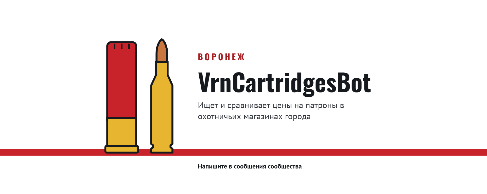
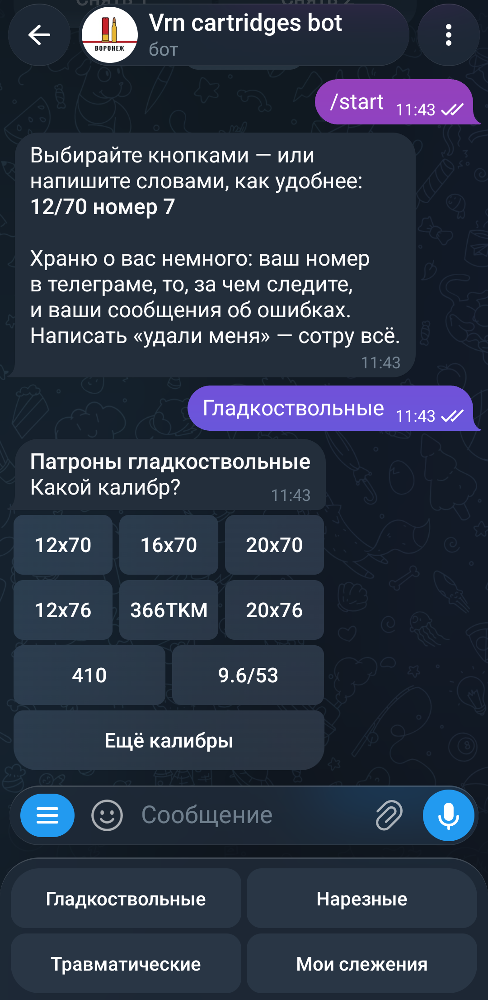
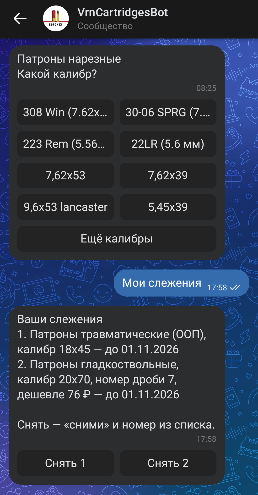

# VrnCartridgesBot — где патроны дешевле в Воронеже

**Бот для Telegram и ВКонтакте, который сравнивает цены на патроны в оружейных магазинах Воронежа и сообщает, когда нужное появилось в наличии или подешевело.**

[](https://t.me/VrnCartridgesBot)
[](https://vk.com/vrncartridgesbot)

> Это витрина проекта: описание и примеры работы. Исходный код хранится в закрытом репозитории.

---

## Какую задачу решает

Магазины указывают цены по-разному: один — за патрон, другой — за пачку из 10 штук, третий — за патрон, но продаёт только кратно 25. Сравнить такие цифры на глаз почти невозможно.

Бот собирает каталоги магазинов, **приводит все цены к цене за один патрон** и рядом показывает, сколько придётся заплатить за минимальную покупку.

## Возможности

- **Поиск кнопками** — тип патронов → калибр → (для гладкоствольных) тип снаряда и номер дроби или картечи.
- **Поиск обычной фразой** — «12/70 номер 7», «308 win», «травматические 9 ра». Калибр понимается в любом написании: «.308 Win», «7,62х51» и «308» — одно и то же.
- **Ответ по делу** — самые дешёвые позиции в наличии и ссылка на страницу со всеми ценами.
- **Слежение за товаром**
  - нет в наличии — бот напишет, когда появится;
  - есть в наличии — сообщит, когда подешевеет на 10, 15, 20% или до вашей цены.
- **Забота о пользователе** — список своих слежений, жалоба владельцу в один клик, полное удаление своих данных по команде «удали меня».

## Магазины

| Магазин | Сайт |
|---|---|
| ОхотАктив | [ohotaktiv.ru](https://ohotaktiv.ru) |
| Оружейный салон «Охотник» | [gunshunt.ru/voronezh](https://gunshunt.ru/voronezh/) |
| Охотник и рыболов | [oxotnikirybolov.ru](https://oxotnikirybolov.ru) |

Категории: гладкоствольные, нарезные и травматические патроны.

## Скриншоты

| Telegram: начало и выбор калибра | ВКонтакте: калибры и слежения |
|---|---|
|  |  |

## Как это устроено

```
 магазины ──> сбор каталогов ──> база цен
                                                      │
            Telegram ─┐                               ├──> страницы с ценами
                      ├──> бот ──── отвечает ─────────┤
          ВКонтакте ──┘                               └──> уведомления о слежениях
```

- Каталоги трёх магазинов обновляются несколько раз в сутки, без нагрузки на серверы.
- На вопросы бот отвечает из собранной базы и не обращается к магазинам при каждом запросе — это быстро и не нагружает их сайты.
- Правила сайтов для роботов (`robots.txt`) соблюдаются.
- Всё работает на собственном арендованном сервере.

**Технологии:** Python, SQLite, Telegram Bot API, VK API, nginx, Let's Encrypt.

## Честно об ограничениях

- Только Воронеж и только патроны.
- Если размер пачки не удалось определить, позиция показывается, но не сравнивается: цена «наугад» не считается.
- Цена распроданных товаров показывается отдельно и как есть: магазин мог не обновить старый ценник.

---

Бот читает только общедоступные страницы каталогов и ничего не покупает. Оружейные товары продаются по лицензии и с возрастным ограничением.
